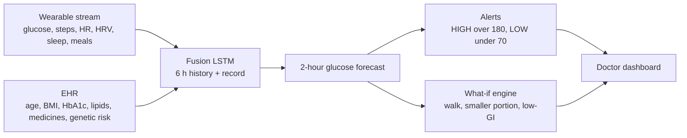
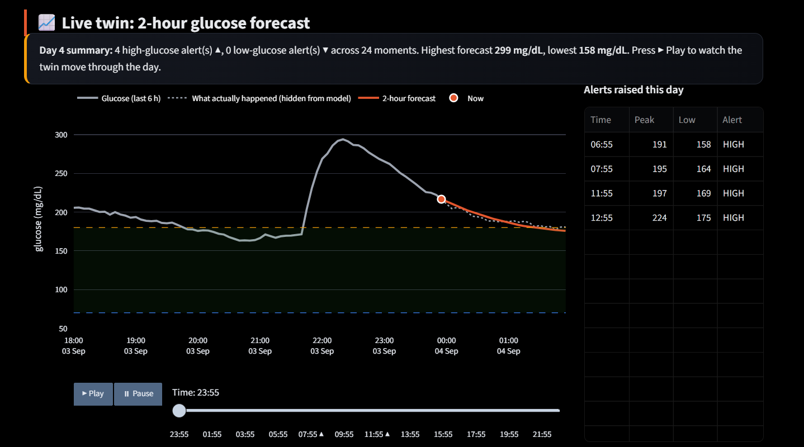
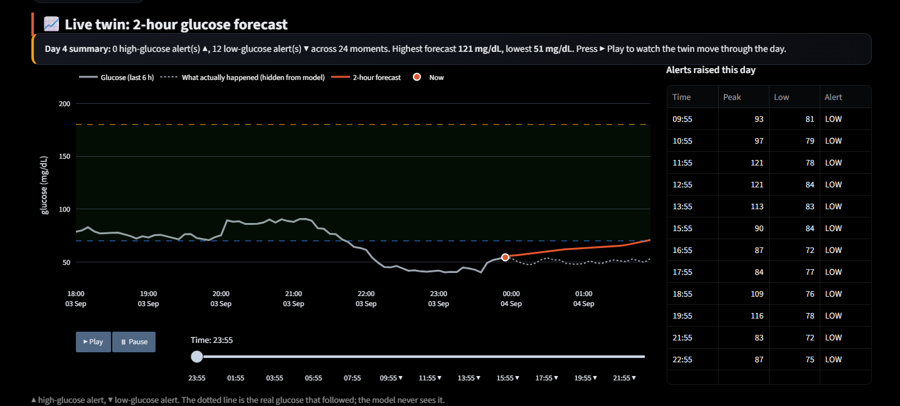
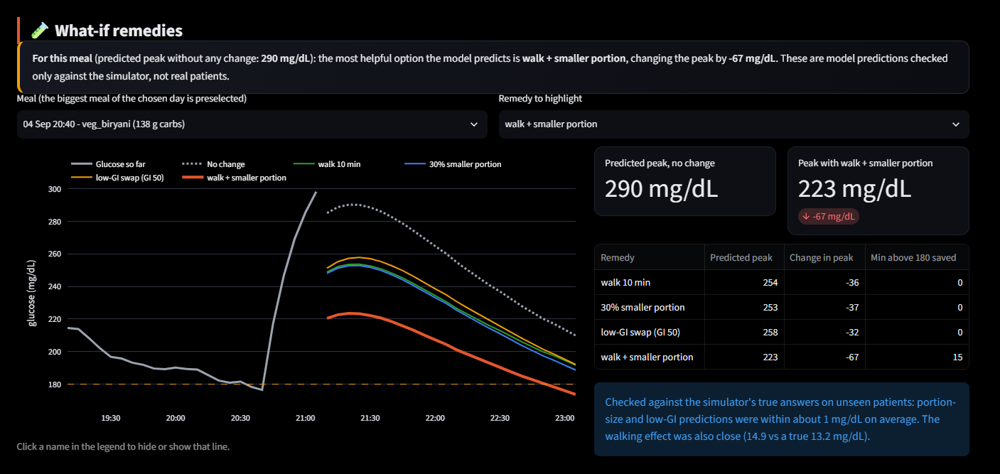
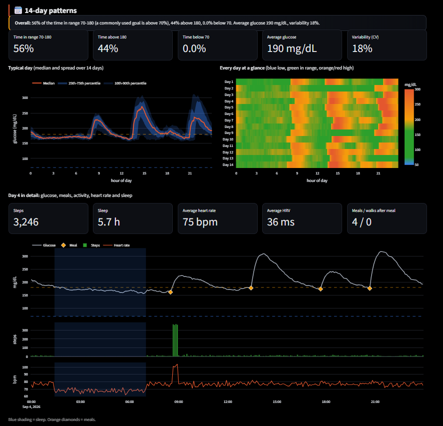

# Type 2 Diabetes Digital Twin

**Team:** bloom | **College:** Shri Shankaracharya Mahavidyalaya | **Author:** Venkatesh (solo) | **Contact:** shuklavenkatesh657@gmail.com

A proof-of-concept digital twin for **Type 2 Diabetes (T2D)**, built for the Happiest Health Digital Twin Challenge 2026. It combines a patient's health record (EHR) with a stream of wearable sensor data, forecasts glucose **2 hours ahead**, raises an alert **before** a glucose spike or a low, and lets a doctor test simple "what if" remedies.

> **Important:** This is a research prototype built on **100% synthetic data**. It is not medical advice and has not been validated on real patients.

---

## 1. The problem

People with T2D often find out about a glucose spike only after it has happened. A digital twin that is updated continuously can warn earlier and show which small change (a short walk, a smaller portion, a lower-GI swap) would help most.

- **Condition:** Type 2 Diabetes
- **Adverse event predicted:** glucose above **180 mg/dL** (high), and below **70 mg/dL** (low), up to **2 hours ahead**

## 2. What it does

| Layer | What it does | File(s) |
|---|---|---|
| 1 + 2 | Synthetic EHR and sensor generator (glucose, steps, heart rate, HRV, sleep, meals), Indian meal menu | `make_data.py` |
| 3 | Fusion LSTM: 6 hours of sensor history + the patient's EHR, predicts the next 2 hours | `train_baseline.py`, `fusion_model.py` |
| 4 | Adverse event alerts (HIGH > 180, LOW < 70) with precision / recall / F1 | `alerts.py` |
| 5 | What-if remedy engine (walk, smaller portion, low-GI swap), checked against the simulator's true answers | `whatif.py`, `whatif_truth_check.py`, `whatif_finetune.py` |
| 6 | Doctor dashboard (Streamlit) | `dashboard.py` |
| Check | 5-seed reproducibility check | `seed_check.py` |

## 3. Architecture



Model settings: history 72 readings (6 h), horizon 24 readings (2 h), hidden size 64, 12 epochs, seed 42.

## 4. Dashboard

Run it with `streamlit run dashboard.py`. All patients shown are synthetic, and the avatar is an illustration, not a photo.

**Live twin: forecast and alerts** (T03, day 4: 4 high-glucose alerts)



**Low-glucose alert** (T06, day 4: 12 low-glucose alerts)



**What-if remedies** (T03, a large 138 g-carb meal). This is an extreme example. The average predicted effect of walk + smaller portion across meals is about 20 mg/dL (see section 5.3).



**14-day patterns** (T03: 56% of time in range 70-180, 44% above 180, average 190 mg/dL)



## 5. Results

All results are on **10 unseen test patients (T01-T10)** that were never used in training. Training used 150 synthetic patients, 14 days each.

### 5.1 Forecast accuracy (2-hour RMSE, 5 seeds)

| Model | RMSE (mg/dL), mean ± std |
|---|---|
| Glucose-only LSTM | 18.42 ± 0.40 |
| Fusion LSTM (sensor + EHR) | 18.57 ± 0.50 |

**Honest finding:** fusion was better in only 2 of 5 seeds, and the average difference (-0.14 mg/dL) is within noise. We do **not** claim fusion improves 2-hour RMSE. Its value here is per-patient context: medicine-aware alerts and patient-specific remedy ranking.

### 5.2 Alerts (single run, 10 unseen patients)

**HIGH (> 180 mg/dL):** 1,661 new events in 10,695 windows

| Method | Precision | Recall | F1 |
|---|---|---|---|
| Trend baseline | 0.37 | 0.19 | 0.25 |
| Glucose-only LSTM | 0.76 | 0.49 | 0.59 |
| Fusion LSTM | 0.82 | 0.53 | 0.65 |
| Fusion, sensitive (margin +15) | 0.54 | 0.85 | 0.66 |

**LOW (< 70 mg/dL):** 239 new events

| Method | Precision | Recall | F1 |
|---|---|---|---|
| Fusion, default | 1.00 | 0.14 | 0.24 |
| Fusion, sensitive | 0.40 | 0.82 | 0.53 |

The default setting raised **0 false low alarms** but missed most lows. The sensitive setting catches 82% of lows at the cost of more false alarms. The dashboard defaults to the sensitive setting, because a missed low is the more dangerous mistake.

*These alert numbers come from a single run and are not seed-averaged.*

### 5.3 What-if remedies vs the simulator's true answers

| Remedy | True avg drop (mg/dL) | Predicted avg drop | Bias | MAE | Correlation |
|---|---|---|---|---|---|
| Walk 10 min | 13.23 | 14.90 | +1.67 | 2.37 | 0.96 |
| 30% smaller portion | 11.29 | 11.42 | +0.13 | 2.60 | 0.94 |
| Low-GI swap (GI 50) | 11.97 | 11.91 | -0.06 | 2.59 | 0.94 |
| Walk + smaller portion | 20.42 | 23.12 | +2.70 | 3.74 | 0.96 |

The walk effect is slightly overestimated, and the combined remedy is slightly optimistic (+2.7 mg/dL).
## 5.4 Real-data check (CGMacros, no retraining)

To test whether the twin works beyond our simulator, we ran the trained models **unchanged** on
[CGMacros](https://physionet.org/content/cgmacros/1.0.0/), an anonymized, open-access dataset of 45 real adults
(14 Type 2 Diabetes, 16 pre-diabetes, 15 healthy) with Dexcom G6 CGM, Fitbit activity, logged meals and blood tests,
10 days each. Script: `cgmacros_test.py`. The data is not stored in this repository.

**2-hour forecast error (RMSE, mg/dL), T2D participants (14 people, 12,884 windows):**

| Model | 30 min | 60 min | 120 min |
|---|---|---|---|
| No change (flat) | 23.1 | 36.6 | 52.2 |
| Trend | 28.1 | 55.1 | 107.0 |
| Sensor-only LSTM | 22.4 | 34.3 | 46.1 |
| Fusion twin (dashboard model) | 24.0 | 35.7 | 46.0 |

Pre-diabetes: 33.3 vs 37.7 (flat). Healthy: 27.4 vs 29.0 (flat).

**HIGH alerts, T2D:** default precision 0.68, recall 0.08; sensitive mode precision 0.57, recall 0.37 (F1 0.45, trend 0.38).

**Honest reading:** with no retraining, the twin beats a "no change" guess on real people at 2 hours (about 12% lower
error for T2D), so it learned real glucose behaviour, not only simulator rules. But errors are about 2.5x larger than on
synthetic data, it is slightly worse than "no change" at 30 minutes, the health record still adds nothing, and alerts miss
most real highs. CGMacros has no HRV, sleep, meal GI or medicine data, so these were filled with typical values.
**Next step:** fine-tune on CGMacros with patients held out for testing.

## 5.5 Data sources and compliance

All models are trained only on synthetic data. No real patient data is used for training, in line with the challenge's
data rules (anonymized, open-source or synthetic only).

| Layer | Source | Type |
|---|---|---|
| EHR (static) | Own generator, `make_data.py` | Synthetic |
| Sensor stream (dynamic) | Own generator, mimicking a 5-minute CGM (Dexcom / Libre) plus Apple Health / Google Fit signals | Synthetic |
| External test only | CGMacros v1.0.0, PhysioNet (CC BY-NC-SA 4.0) | Anonymized, open-access |

How our synthetic signals map to wearable platforms:

| Our column | Apple Health (HealthKit) | Google Fit / medical IoT |
|---|---|---|
| `glucose_mgdl` (every 5 min) | Blood Glucose | CGM (Dexcom G6 / FreeStyle Libre) |
| `steps` | Step Count | Step count |
| `heart_rate` | Heart Rate | Heart rate (bpm) |
| `hrv_ms` | Heart Rate Variability (SDNN) | HRV |
| `sleeping` | Sleep Analysis | Sleep segments |
| `carbs_g`, `meal_gi` | Dietary Carbohydrates | Nutrition |

**Citation:** Das, A. et al. CGMacros: a scientific dataset for personalized nutrition and diet monitoring. PhysioNet (2025).
https://physionet.org/content/cgmacros/1.0.0/

## 6. Limitations (please read)

1. **All data is synthetic.** The twin has never seen a real patient. Results show the pipeline works against a simulator, not that it works clinically.
2. **Remedy checks are against the same simulator** that generated the data, so they test internal consistency, not real-world physiology.
3. **Fusion gives no measurable 2-hour RMSE gain** over glucose-only (section 5.1).
4. **Walk remedy is slightly optimistic** (+1.7 mg/dL; +2.7 when combined with a smaller portion).
5. **Alert numbers are from a single run**, not averaged over seeds.
6. **Low-glucose detection** depends on the sensitivity setting; the default misses most lows.
7. The dashboard's scroll animation works in Edge and Chrome only.
8. Not a medical device. Not for clinical use.

## 7. Validation plan (next steps)

1. Test on a public real CGM dataset and report the gap between synthetic and real results.
2. Add prediction intervals and a Clarke Error Grid analysis for clinical safety of the forecasts.
3. Tune alert thresholds on a separate validation set (not the test patients).
4. Report alerts per episode and warning time, not per overlapping window.
5. Pilot with clinicians under proper ethics approval before any patient-facing use.

## 8. How to run

Tested with **Python 3.14.8** and **torch 2.14.1** on Windows.

```bash
git clone https://github.com/venkatesh-spec01/diabetes-digital-twin.git
cd diabetes-digital-twin
python -m venv venv
venv\Scripts\activate        # Windows
# source venv/bin/activate   # macOS / Linux
pip install -r requirements.txt
streamlit run dashboard.py
```

Then open `http://localhost:8501` and choose a patient (T01-T10) in the sidebar.

The generated data (`data/`) and trained models (`models/`) are included in the repository, so the dashboard runs without retraining. To regenerate everything from scratch, run the scripts in order:

```bash
python make_data.py
python train_baseline.py
python fusion_model.py
python whatif_finetune.py
```

Other checks: `alerts.py` (alerts), `whatif_truth_check.py` (remedy validation), `seed_check.py` (5-seed check).

## 9. Repository layout

```
dashboard.py                  Doctor dashboard (final version)
make_data.py     Synthetic EHR + sensor data
train_baseline.py       Glucose-only LSTM
fusion_model.py            Fusion LSTM
alerts.py             Adverse event alerts
whatif.py          What-if remedy engine
whatif_truth_check.py      Remedy validation vs simulator
whatif_finetune.py    Counterfactual fine-tuning
seed_check.py             5-seed reproducibility check
data/  models/  plots/     Data, trained models, result plots
docs/                      Dashboard screenshots
```

## 10. Licence

MIT. See `LICENSE`.
Order I built the scripts (the phase numbers match the "step" numbers used in this README):

| Phase | Script | What it does |
|---|---|---|
| 1 | `make_data.py` | Make the synthetic patients and sensor data |
| 2 | `train_baseline.py` | Train the sensor-only LSTM (baseline) |
| 3 | `fusion_model.py` | Train the fusion LSTM (sensors + patient record) |
| 4 | `alerts.py` | High and low glucose alerts |
| 5 | `whatif.py` | What-if engine (walk, portion, low-GI) |
| 6 | `whatif_truth_check.py` | Check the what-if answers against the simulator |
| 7 | `whatif_finetune.py` | Fine-tune the what-if behaviour |
| 8 | `seed_check.py` | Repeat with 5 seeds |
| 9 | `walk_fix.py` | Fix the walk remedy bias |
| 9b | `blend_test.py` | Test the chosen 75% blend (dashboard model) |
| 10 | `cgmacros_test.py` | Test on real people (CGMacros) |
| 11 | `cgmacros_finetune.py` | Fine-tune on real people, test on others |

## 11. Submission documents

- Architecture diagram: [docs/architecture_diagram.pdf](docs/architecture_diagram.pdf)
- Presentation: [docs/presentation.pdf](docs/presentation.pdf)
- Demo video: <paste your unlisted YouTube link here>
- Open-source licence: MIT, see [LICENSE](LICENSE)