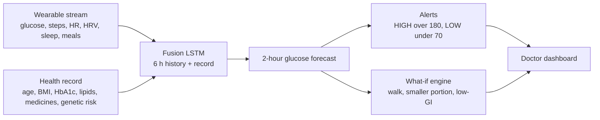
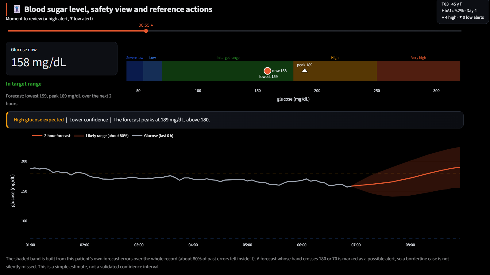
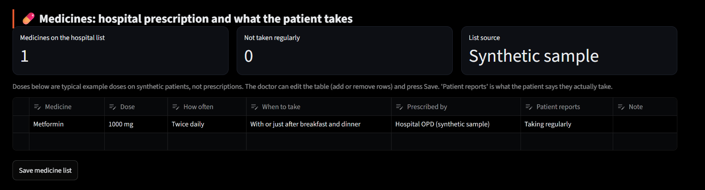
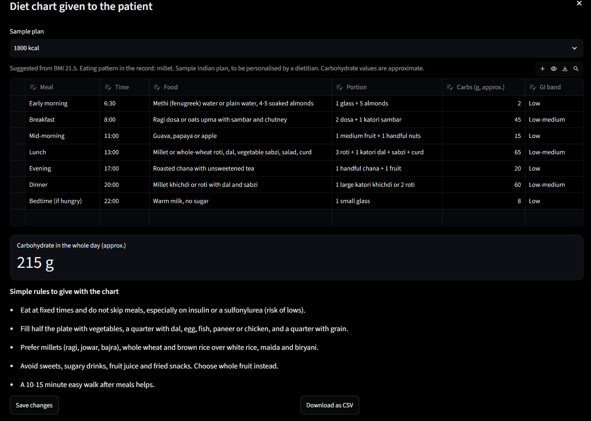
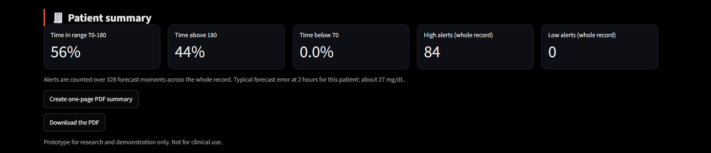
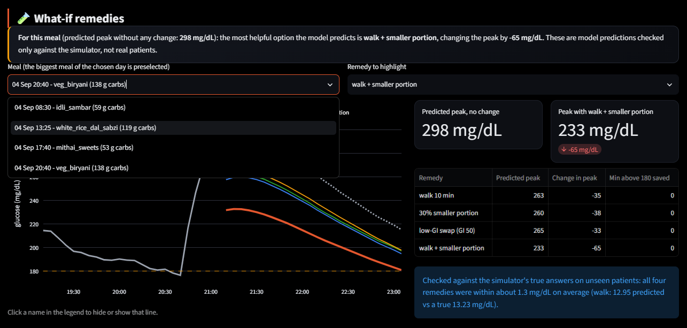

# Type 2 Diabetes Digital Twin

A digital twin for people with Type 2 Diabetes. It reads a patient's health record and their wearable data, forecasts glucose two hours ahead, warns before a high or a low, and lets a doctor try simple "what if" changes like a short walk or a smaller portion.

Built for the Happiest Health Digital Twin Challenge 2026.

> **Please read this first.** This is a research prototype, not a medical tool. The models were trained on synthetic data only. I also tested them on real anonymized data (CGMacros, sections 5.4 and 5.5) and they are not clinically validated. I built this project with AI help (Claude) for coding, debugging and writing. I ran every script, checked the results and made the decisions myself.

---

## Submission details

### Team details
- **Team name:** bloom
- **Team member:** Venkatesh Shukla (solo)
- **Contact:** shuklavenkatesh657@gmail.com
- **GitHub:** [venkatesh-spec01](https://github.com/venkatesh-spec01)

### College
St. Thomas College

### Project title
Type 2 Diabetes Digital Twin: forecast glucose 2 hours ahead, warn early, test small changes

### Problem statement
Most people with Type 2 Diabetes find out about a glucose spike after it has already happened. A sensor shows the glucose right now. It does not show the next two hours, and that is exactly the window when a 10-minute walk or a smaller meal can still change the result. A missed low is even more dangerous than a high.

Doctors usually see a patient for a short visit every few months, with only a few readings to look at. I also talked to a nurse who looks after diabetic patients. She told me she keeps checking each patient's blood sugar, reading the doctor's notes and looking up which medicines the patient takes. She wished for one place that shows which patient needs which insulin shot and how strong. Her other big problem was paper: files and reports pile up, and sometimes a record gets torn. That is one conversation with one nurse, so it shows direction and is not proof.

### Healthcare use case
This is a tool for the doctor, not for the patient. It sits in front of the doctor as a dashboard and shows:

- where the patient's glucose is now and where it is heading in the next 2 hours
- a HIGH alert (above 180 mg/dL) or a LOW alert (below 70 mg/dL) before it happens, with an uncertainty band so the doctor can see how sure the model is
- a what-if view: "what happens if this patient walks for 10 minutes after the meal?" or "eats a 30% smaller portion?"
- the patient's medicines, a diet chart and a one-page summary the doctor can print

What it does not do: it never calculates a medicine dose and never diagnoses anything. Medicine rows only say "doctor decides". Every number on screen is a model prediction for the doctor to read.

### Technical stack
- **Language:** Python (tested on Python 3.14.8, Windows)
- **Deep learning:** PyTorch 2.14.1 (LSTM networks, trained on CPU)
- **Data and maths:** pandas, NumPy
- **Dashboard:** Streamlit, with Plotly and matplotlib for charts
- **Real-data test:** CGMacros v1.0.0 from PhysioNet
- All exact versions are pinned in [requirements.txt](requirements.txt)

### AI/ML model details
- **Model:** a fusion LSTM. It has two parts that meet at the end.
  - Sensor branch: an LSTM (hidden size 64) reads the last **72 readings (6 hours, one every 5 minutes)** of **10 signals**: glucose, steps, heart rate, HRV, sleeping flag, carbs, meal GI, sine and cosine of the time of day, and a walk flag.
  - Record branch: a small network (two layers of 32) reads the patient record (13 columns, 14 numbers after encoding): age, BMI, HbA1c, lipids, medicines, genetic risk and so on.
  - The two outputs, plus 3 walk-timing flags (walked in the last 30, 60 and 120 minutes), go into a head with 64 hidden units that outputs **24 values**: the change in glucose over the next 2 hours.
- **Training:** MSE loss, Adam optimizer (learning rate 2e-3), batch size 256, 12 epochs, seed 42. The first 80% of each patient's days are for training and the last 20% for validation. The best epoch is chosen by validation error at 120 minutes. The fusion model also uses a little weight decay (1e-5) and adds a small amount of noise (0.1 times) to the record during training.
- **Training data:** 150 synthetic patients with 14 days each. 10 hand-made, harder test patients (T01 to T10) were never used in training.
- **Alerts:** HIGH above 180, LOW below 70. There is a "sensitive" mode that warns 15 mg/dL earlier for lows. The uncertainty band (about 80%) comes from each patient's own past forecast errors. If the band crosses a limit, the dashboard shows a "possible" alert.
- **What-if engine:** it re-runs the forecast with one change applied 30 minutes after the meal. I checked it against the simulator's true answer, and fine-tuned it with counterfactual examples so the remedies move the curve the right way.
- **Honest summary of results:** details are in section 5. In short, the model beats simple baselines at alerts, fusion does not improve the 2-hour error on synthetic data, and on real people the error is about 2.5 times larger than on synthetic data.

### Demo video
**Watch the demo (unlisted YouTube): https://youtu.be/jIUueEtXRys**

### Licence
MIT. See [LICENSE](LICENSE).

### Architecture diagram
[docs/architecture_diagram.pdf](docs/architecture_diagram.pdf)

### Presentation
[docs/presentation.pdf](docs/presentation.pdf)

### Public links
The repository is public, and the video is an unlisted YouTube link that opens without signing in. The architecture diagram and presentation are in the `docs/` folder of this repository.

---

## 1. Why I made this

Many people with T2D only find out about a spike after it happens, and many are diagnosed late. I wanted to see whether a model that knows a patient's record and watches their wearable data could warn a couple of hours ahead, and show which small change would help most.

- Condition: Type 2 Diabetes
- Events predicted: glucose above 180 mg/dL (high) and below 70 mg/dL (low), up to 2 hours ahead

## 2. What is in the project

| Layer | What it does | Files |
|---|---|---|
| 1 and 2 | Makes synthetic patient records and sensor data (glucose, steps, heart rate, HRV, sleep, meals) with an Indian meal menu | `make_data.py` |
| 3 | Fusion LSTM: 6 hours of sensor history plus the patient record, predicts the next 2 hours | `train_baseline.py`, `fusion_model.py` |
| 4 | Alerts for HIGH and LOW, scored with precision, recall and F1 | `alerts.py` |
| 5 | What-if engine (walk, smaller portion, low-GI swap), checked against the simulator's true answer | `whatif.py`, `whatif_truth_check.py`, `whatif_finetune.py` |
| 6 | Doctor dashboard in Streamlit: live forecast and alerts, blood sugar bar, actions list, medicines, diet chart, patient summary PDF | `dashboard.py`, `doctor_logic.py`, `doctor_panels.py`, `clinical_reference.py` |
| 5 (fix) | Fix for the walk remedy bias, using a weight blend picked on validation data | `walk_fix.py`, `blend_test.py` |
| Real-data check | The trained models run unchanged on CGMacros (real, anonymized) | `cgmacros_test.py` |
| Real-data fine-tuning | Fine-tune on some real people, test on others never seen | `cgmacros_finetune.py` |
| Check | Same experiment repeated with 5 seeds | `seed_check.py` |

## 3. How it works



Quick settings: 72 readings of history (6 h), 24 readings forecast (2 h), hidden size 64, 12 epochs, seed 42.

## 4. The dashboard

Run it with `streamlit run dashboard.py`. Everything in it (patients, medicines, diet charts) is synthetic sample data, and the avatar is an illustration, not a photo.

**Live twin with forecast and alerts** (patient T03, day 4: 4 high-glucose alerts)


**Low-glucose alert** (patient T06, day 4: 12 low-glucose alerts)


**Blood sugar level and safety panel.** A bar shows where the current glucose sits (severe low, low, target, high, very high). The alert also shows an uncertainty band built from this patient's own past forecast errors, so borderline cases show up as "possible high" or "possible low", and low-confidence forecasts are flagged.



**Actions list.** When glucose is heading high or low, the doctor sees a list of actions grouped by type (lifestyle, diet, monitoring, medicine) and by timing (right now, before the meal, with the meal, after the meal, later). Medicine rows only say "doctor decides" and never suggest a dose. The lists follow common diabetes guidance and can be edited to match a hospital's own protocol.

**Medicines.** What the hospital prescribed (drug, dose, how often, when to take it) sits next to what the patient says they take, with a note field. The doctor can edit the table and the edits are saved.



**Diet chart.** The chart given to the patient (Indian meals, portions, approximate carbs and GI band) opens in its own window when the doctor clicks the button. It can be edited and saved.



**Patient summary.** One page with time in range, alert counts, medicines and the glucose record. It can be downloaded as a PDF.



**What-if remedies** (patient T03, a large 138 g carb meal). This is an extreme case. Across all meals, a walk plus a smaller portion lowers the peak by about 20 mg/dL (section 5.3).



**14-day patterns** (patient T03: 56% of time in range 70 to 180, 44% above 180, average 190 mg/dL)


## 5. Results

Everything below is on 10 test patients (T01 to T10) that were never used in training. Training used 150 synthetic patients with 14 days each.

### 5.1 Forecast accuracy (2-hour RMSE, 5 seeds)

| Model | RMSE in mg/dL, mean ± std |
|---|---|
| Sensor-only LSTM (no patient record) | 18.42 ± 0.40 |
| Fusion LSTM (sensor + record) | 18.57 ± 0.50 |

Fusion was better in only 2 of 5 seeds, and the average difference (-0.14 mg/dL) is within noise. So I do not claim that fusion improves the 2-hour error. What it adds is patient-specific context, such as medicine-aware alerts and remedy ranking for each patient.

### 5.2 Alerts (one run, 10 unseen patients)

HIGH (above 180 mg/dL): 1,661 new events in 10,695 windows

| Method | Precision | Recall | F1 |
|---|---|---|---|
| Trend baseline | 0.37 | 0.19 | 0.25 |
| Sensor-only LSTM | 0.76 | 0.49 | 0.59 |
| Fusion LSTM | 0.82 | 0.53 | 0.65 |
| Fusion, sensitive (margin +15) | 0.54 | 0.85 | 0.66 |

LOW (below 70 mg/dL): 239 new events

| Method | Precision | Recall | F1 |
|---|---|---|---|
| Fusion, default | 1.00 | 0.14 | 0.24 |
| Fusion, sensitive | 0.40 | 0.82 | 0.53 |

The default setting gave no false low alarms but missed most lows. The sensitive setting catches 82% of lows, with more false alarms. The dashboard uses the sensitive setting because a missed low is the more dangerous mistake. These alert numbers come from a single run and are not averaged over seeds.

### 5.3 What-if remedies against the simulator's true answers

| Remedy | True avg drop (mg/dL) | Predicted avg drop | Bias | MAE | Correlation |
|---|---|---|---|---|---|
| Walk 10 min | 13.23 | 12.95 | -0.28 | 1.79 | 0.97 |
| 30% smaller portion | 11.29 | 11.97 | +0.67 | 2.52 | 0.94 |
| Low-GI swap (GI 50) | 11.97 | 12.49 | +0.51 | 2.44 | 0.93 |
| Walk + smaller portion | 20.42 | 21.69 | +1.28 | 3.26 | 0.96 |

My first fine-tuned model (step 7) promised too much for the walk (+1.67 mg/dL) and for walk plus smaller portion (+2.70). In step 9 I blended the original and fine-tuned weights. I picked the 75% blend using validation days only (later days of the training patients) and tested it once on the unseen patients. It cut the walk bias to -0.28, halved the combined bias and lowered the MAE for all four remedies, while the 2-hour forecast error stayed about the same (17.96 vs 17.91 mg/dL).

### 5.4 Real-data check on CGMacros (no retraining)

I wanted to know if the twin works outside my own simulator, so I ran the trained models unchanged on [CGMacros](https://physionet.org/content/cgmacros/1.0.0/). It is an open, anonymized dataset of 45 real adults (14 Type 2 Diabetes, 16 pre-diabetes, 15 healthy) with Dexcom G6 CGM, Fitbit activity, logged meals and blood tests, 10 days each. The script is `cgmacros_test.py`. The data is not stored in this repository.

2-hour forecast error (RMSE, mg/dL) for the T2D participants (14 people, 12,884 windows):

| Model | 30 min | 60 min | 120 min |
|---|---|---|---|
| No change (flat) | 23.1 | 36.6 | 52.2 |
| Trend | 28.1 | 55.1 | 107.0 |
| Sensor-only LSTM | 22.4 | 34.3 | 46.1 |
| Fusion twin (dashboard model) | 24.0 | 35.7 | 46.0 |

Pre-diabetes: 33.3 vs 37.7 (flat). Healthy: 27.4 vs 29.0 (flat).

HIGH alerts for T2D: default precision 0.68, recall 0.08. Sensitive mode: precision 0.57, recall 0.37 (F1 0.45, trend 0.38).

What I take from this: with no retraining, the twin beats a "no change" guess on real people at 2 hours (about 12% lower error for T2D), so it learned something real and not only the simulator's rules. But the errors are about 2.5 times larger than on synthetic data, it is slightly worse than "no change" at 30 minutes, the health record adds nothing yet, and the alerts miss most real highs. CGMacros has no HRV, sleep, meal GI or medicine data, so I filled those with typical values.

CGMacros was recorded in the USA (Santa Barbara, California), so this is not a test on Indian patients or Indian diets.

### 5.5 Fine-tuning on real people, tested on people never seen

Script: `cgmacros_finetune.py`. I split the 45 CGMacros people by person, never by time window, with seed 42 (the split is saved in `models/cgmacros_split.csv`):

- Train: 29 people. Valid: 6 people (only used to pick the best training round). Test: 10 people (3 T2D, 4 pre-diabetes, 3 healthy), scored once at the end.
- Each round mixes in synthetic windows (1x or 3x the number of real windows) so the model does not forget what it learned from synthetic data.

Error on the real test people (mg/dL at 30 / 60 / 120 minutes):

| Group | No change | Before (dashboard model) | Fine-tuned, 1x synthetic mix | Fine-tuned, 3x synthetic mix |
|---|---|---|---|---|
| T2D (3 people) | 24.4 / 38.9 / 56.0 | 25.6 / 38.5 / 50.2 | 21.9 / 34.5 / 46.9 | 22.6 / 35.5 / 48.3 |
| All 10 people | 20.0 / 29.6 / 39.8 | 20.0 / 28.5 / 35.6 | 17.8 / 25.5 / 32.3 | 18.0 / 26.0 / 32.9 |

T2D HIGH-alert recall (default / sensitive): before 0.10 / 0.47, fine-tuned 0.19 / 0.61 (1x) and 0.15 / 0.55 (3x).

Cost on the synthetic test patients (a safety check):

| | Before | 1x mix | 3x mix |
|---|---|---|---|
| Synthetic 2-hour RMSE | 17.96 | 18.66 | 18.18 |
| Walk remedy bias (mg/dL) | -0.28 | -1.69 | -1.28 |
| 30% smaller portion bias | +0.67 | +1.41 | +1.05 |
| Low-GI swap bias | +0.51 | +1.63 | +1.19 |
| Walk + portion bias | +1.28 | +0.93 | +0.64 |

Training on real people lowered the 2-hour error on unseen real people by about 4% to 9% (up to about 14% at 30 minutes for T2D) and roughly doubled the share of real highs caught in default mode. The price is that the what-if numbers drift by 1 to 2 mg/dL. The test group is only 10 people (3 with T2D), so small differences are noise, and I looked at the same test people for both settings.

The dashboard keeps the original model (`fusion_cf_blend75.pt`), so the numbers in this README match what the dashboard shows. The fine-tuned models are saved as `models/fusion_real_ft1.pt` and `fusion_real_ft1b.pt` on the machine that ran the script. The committed script uses the 3x mix (`SYN_RATIO = 3.0`). Set it to `1.0` for the 1x run. Results are in `models/cgmacros_finetune_results.csv` (1x) and `models/cgmacros_finetune_results_b.csv` (3x).

## 6. Data sources and compliance

The models the dashboard uses are trained only on synthetic data. Real data is used to test them and, in a separate experiment, to fine-tune with held-out people. All of it is anonymized and open-access, in line with the challenge's data rules (anonymized, open-source or synthetic only). Raw CGMacros files are never stored in this repository.

The synthetic patient records come from my own generator (`make_data.py`), in the spirit of tools like Synthea. No real patient records were used. The meal menu in the generator is Indian, but the real data I tested on (CGMacros) is from the USA.

| Layer | Source | Type |
|---|---|---|
| Patient record (static) | My own generator, `make_data.py` | Synthetic |
| Sensor stream (dynamic) | My own generator, mimicking a 5-minute CGM (Dexcom / Libre) plus Apple Health / Google Fit signals | Synthetic |
| External test and fine-tuning experiment | CGMacros v1.0.0, PhysioNet (CC BY-NC-SA 4.0), USA | Anonymized, open-access |

How my synthetic signals map to wearable platforms:

| My column | Apple Health (HealthKit) | Google Fit / medical IoT |
|---|---|---|
| `glucose_mgdl` (every 5 min) | Blood Glucose | CGM (Dexcom G6 / FreeStyle Libre) |
| `steps` | Step Count | Step count |
| `heart_rate` | Heart Rate | Heart rate (bpm) |
| `hrv_ms` | Heart Rate Variability (SDNN) | HRV |
| `sleeping` | Sleep Analysis | Sleep segments |
| `carbs_g`, `meal_gi` | Dietary Carbohydrates | Nutrition |

Citations:
- Gutierrez-Osuna, R., Kerr, D., Mortazavi, B., & Das, A. (2025). *CGMacros: a scientific dataset for personalized nutrition and diet monitoring* (version 1.0.0). PhysioNet. https://doi.org/10.13026/3z8q-x658
- Das, A., Kerr, D., Glantz, N., Bevier, W., Santiago, R., Gutierrez-Osuna, R., Mortazavi, B. CGMacros: a pilot scientific dataset for personalized nutrition and diet monitoring. *Scientific Data* 12, 1557 (2025). https://doi.org/10.1038/s41597-025-05851-7

## 7. Limitations (things I want you to know)

1. The dashboard model is trained on synthetic data only. Run unchanged on real anonymized people (section 5.4), it still beats a "no change" guess at 2 hours, but its error is about 2.5 times larger and it misses most real highs. Fine-tuning on real people lowers the 2-hour error by about 4 to 9% (section 5.5), but I tested it on only 10 people. It is not clinically validated.
2. No Indian patient data. The generator uses an Indian meal menu, but the only real data I tested on is from the USA. I have not checked the twin on Indian patients or Indian diets.
3. The remedy checks use the same simulator that made the data, so they test internal consistency, not real physiology.
4. Fusion gives no measurable 2-hour gain over the sensor-only model (section 5.1).
5. Walk plus smaller portion is still slightly optimistic (+1.3 mg/dL). The portion and low-GI predictions are within +0.7.
6. The alert numbers come from a single run, not averaged over seeds.
7. Low-glucose detection depends on the sensitivity setting, and the default misses most lows.
8. The dashboard's scroll animation works in Edge and Chrome only.
9. Not a medical device. Not for clinical use.

## 8. Rules and regulation I looked at

If something like this were ever used in a hospital in India, software that forecasts glucose for a doctor would count as Software as a Medical Device under the Medical Devices Rules, 2017, and CDSCO published guidance for medical device software in 2026. My own reading is that a tool that only informs the doctor would sit in Class A or B, but CDSCO makes the final call. I followed the spirit of the usual standards (ISO 13485 for quality, IEC 62304 for the software lifecycle, ISO 14971 for risk) in small ways: one job per script, fixed seeds, a 5-seed test and a 12-risk matrix. The DPDP Act is why I only used synthetic and anonymized open data. I have not applied for any licence and nothing here has been audited against these standards.

## 9. What I would do next

Model:
1. Fine-tune and test on more real CGM datasets, always with whole people held out.
2. Add prediction intervals and a Clarke Error Grid analysis, so the dashboard can show when a forecast is uncertain.
3. Tune alert thresholds on a separate validation set, and report alerts per episode and warning time.
4. Use real Indian recipe data (Indian Nutrient Databank) to improve the Indian meal menu.
5. Try generating the synthetic patient records with Synthea and let my simulator create the matching sensor data.
6. Compare the LSTM with a GRU and a Transformer. I only tested the LSTM against simple baselines.
7. Extend the twin toward early screening: estimating pre-diabetes risk before symptoms appear, since late diagnosis is a big part of the problem.

From prototype to something a clinic could use:
1. Get real Indian patient data through a hospital or clinic partner, with informed consent and ethics approval.
2. Run a small silent pilot with clinicians, comparing forecasts with real CGM readings. The doctor sees the forecast but nobody acts on it yet.
3. Package it as a service (API, tests, container) with privacy and audit logging.
4. Finish clinical validation and the regulatory steps for medical software in India (CDSCO) before any patient-facing use.

## 10. How to run it

Tested with Python 3.14.8 and torch 2.14.1 on Windows.

```bash
git clone https://github.com/venkatesh-spec01/diabetes-digital-twin.git
cd diabetes-digital-twin
python -m venv venv
venv\Scripts\activate        # Windows
# source venv/bin/activate   # macOS / Linux
pip install -r requirements.txt
streamlit run dashboard.py
```

Then open `http://localhost:8501` and pick a patient (T01 to T10) in the sidebar.

The generated data (`data/`) and trained models (`models/`) are in the repository, so the dashboard runs without retraining. To rebuild everything from scratch, run the scripts in this order:

```bash
python make_data.py
python train_baseline.py
python fusion_model.py
python whatif_finetune.py
python walk_fix.py
python blend_test.py
```

`make_medications.py` makes the sample medicine table. The other scripts are `alerts.py` (alerts), `whatif_truth_check.py` (remedy check), `seed_check.py` (5-seed check), `cgmacros_test.py` (real-data check) and `cgmacros_finetune.py` (real-data fine-tuning). The last two need the CGMacros download described in section 5.4.

## 11. What is in each file and folder

```
dashboard.py               Doctor dashboard
doctor_logic.py            Dashboard logic: zones, uncertainty band, medicines, diet, PDF
doctor_panels.py           Dashboard panels
clinical_reference.py      Action lists and sample diet charts (editable)
make_medications.py        Makes the synthetic medicine table (data/medications.csv)
make_data.py               Synthetic patient records and sensor data
train_baseline.py          Sensor-only LSTM
fusion_model.py            Fusion LSTM
alerts.py                  Alerts
whatif.py                  What-if engine
whatif_truth_check.py      Remedy check against the simulator
whatif_finetune.py         Counterfactual fine-tuning
seed_check.py              5-seed check
walk_fix.py                Walk bias fix (blend chosen on validation)
blend_test.py              Tests the chosen 75% blend, which is the model the dashboard uses
cgmacros_test.py           Real-data check on CGMacros (needs the dataset, see 5.4)
cgmacros_finetune.py       Fine-tune on real people, test on people never seen (5.5)
requirements.txt           Pinned package versions
data/  models/  plots/     Data, trained models, result plots
docs/                      Screenshots, architecture diagram and presentation
```

The scripts were built in this order, and the "step" numbers in this README follow it:

| Step | Script |
|---|---|
| 1 | `make_data.py` |
| 2 | `train_baseline.py` |
| 3 | `fusion_model.py` |
| 4 | `alerts.py` |
| 5 | `whatif.py` |
| 6 | `whatif_truth_check.py` |
| 7 | `whatif_finetune.py` |
| 8 | `seed_check.py` |
| 9 and 9b | `walk_fix.py`, `blend_test.py` |
| 10 | `cgmacros_test.py` |
| 11 | `cgmacros_finetune.py` |

---

Made by Venkatesh Shukla, team bloom, St. Thomas College.
